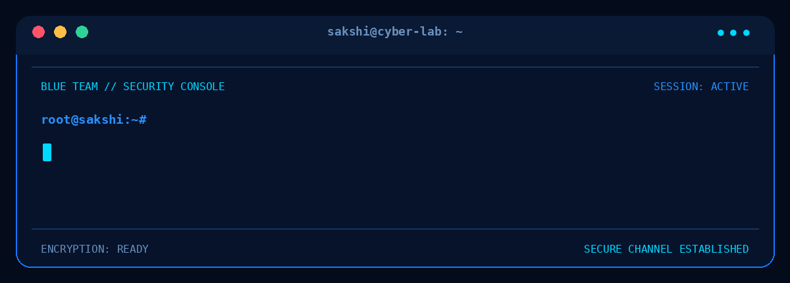

<div align="center">



<br/>

# `SAKSHI CHAVAN`

### CYBERSECURITY ENGINEERING · APPLIED CRYPTOGRAPHY · SECURITY RESEARCH


`[ SYSTEM STATUS: ONLINE ]` &nbsp; ` [ SECURITY MODE: ACTIVE ]`

</div>

---

<table>
<tr>
<td width="55%" valign="top">

## `01 // ABOUT ME`

Hello! I'm **Sakshi**, an MCA Cybersecurity student passionate about understanding how systems work, how attacks happen, and how secure systems are engineered.

I'm developing my skills through hands-on experimentation, security labs, programming and research.

My goal is to become a cybersecurity professional capable of investigating threats, analysing vulnerabilities, responding to incidents and building stronger security systems.

<br/>

### `CURRENT MISSION`

- Strengthening cybersecurity foundations.
- Exploring network and application security.
- Learning Linux and security operations.
- Developing applied cryptography skills.
- Exploring post-quantum cryptography.
- Understanding AI security.

</td>

<td width="45%" valign="top">

## `02 // TERMINAL`

```text
root@sakshi:~$ whoami

Cybersecurity Student

root@sakshi:~$ interests

[+] Network Security
[+] Cryptography
[+] AI Security
[+] Post-Quantum Security
[+] Threat Investigation

root@sakshi:~$ status

Learning       : ACTIVE
Research       : EXPLORING
QuantumVault   : DEVELOPING
Security Labs  : IN PROGRESS

root@sakshi:~$ _
```


</td>
</tr>
</table>

---

## `03 // TECHNICAL ARSENAL`

<div align="center">

### PROGRAMMING & DEVELOPMENT


### SYSTEMS & SECURITY


</div>

### AREAS OF INTEREST

<div align="center">


</div>

---

## `04 // FEATURED PROJECTS`

<table>
<tr>
<td width="50%" valign="top">

### 🔐 QuantumVault

**File Security & Cryptography**

A research-oriented file security project exploring encryption techniques and post-quantum cryptography concepts.

- AES-based file encryption.
- Hybrid cryptographic design.
- Kyber-based key encapsulation exploration.
- Security architecture improvements.

<a href="https://github.com/sakshichavan/Quantum_Vault">

</a>

</td>
<td width="50%" valign="top">

### 🛡️ Cybersecurity Foundation

**Learning & Practical Security**

My ongoing journey towards strong cybersecurity fundamentals.

- Network security.
- Linux security.
- Threat investigation.
- Web application security.
- Hands-on security labs.

<a href="https://github.com/sakshichavan/cybersecurity-foundation">

</a>

</td>
</tr>
</table>

---

## `05 // RESEARCH & EXPLORATION`

```text
[01] Applied Cryptography
     └── Encryption, key management and secure protocols

[02] Post-Quantum Cryptography
     └── Quantum-resistant cryptographic algorithms

[03] AI Security
     └── Understanding threats against AI systems

[04] Threat Detection & Response
     └── Investigating attacks and defensive techniques

[05] Security Engineering
     └── Designing and improving secure applications
```

---

## `06 // GITHUB ACTIVITY`

<div align="center">


<br/>


</div>

---

## `07 // MY LEARNING PHILOSOPHY`

<div align="center">

### UNDERSTAND THE SYSTEM.
### IDENTIFY THE WEAKNESS.
### INVESTIGATE THE EVIDENCE.
### BUILD THE DEFENCE.

<br/>

*Learning by building. Improving through experimentation. Growing through research.*

</div>

---

## `08 // CONNECT WITH ME`

<div align="center">

<a href="https://github.com/sakshichavan">

</a>

<br/><br/>

`BUILD • BREAK • UNDERSTAND • SECURE`

**One experiment at a time. One stronger system at a time.**

</div>
