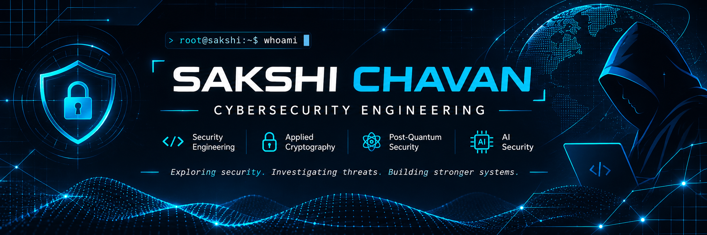

 

---

<table>
<tr>
<td width="58%" valign="top">

## ABOUT ME

Hello! I'm **Sakshi Chavan**, an MCA Cybersecurity student interested in understanding how systems work, how vulnerabilities emerge, and how security can be engineered.

I believe cybersecurity requires more than knowing attack techniques. It requires understanding systems, investigating evidence, solving problems and designing effective defences.

My learning journey combines programming, practical security exercises, technical research and independent project development.

### CURRENT MISSION

- Strengthening computer networks and security fundamentals.
- Developing Linux and operating system security skills.
- Learning vulnerability analysis and incident response.
- Exploring applied and post-quantum cryptography.
- Understanding AI security.
- Building practical cybersecurity tools.

</td>

<td width="42%" valign="top">

## CURRENT STATUS

| Area | Focus |
|---|---|
| Cybersecurity | Building foundations |
| Network Security | Learning |
| Linux Security | Practising |
| Cryptography | Exploring |
| Post-Quantum Security | Research interest |
| AI Security | Exploring |
| QuantumVault | Development |

### PROFESSIONAL GOAL

To become a security engineer capable of analysing attacks, investigating incidents, developing security solutions and protecting real-world systems.

</td>
</tr>
</table>

---

## TECHNICAL SKILLS & TOOLS

### PROGRAMMING & DEVELOPMENT

### SYSTEMS & ENVIRONMENTS

### CYBERSECURITY INTERESTS

---

## FEATURED PROJECTS

<table>
<tr>
<td width="50%" valign="top">

### 🔐 QuantumVault

**File Security & Applied Cryptography**

A research-oriented file security project exploring encryption and post-quantum cryptography.

**Key areas:**
- AES-256-GCM encryption.
- Hybrid cryptographic architecture.
- Kyber-based key encapsulation.
- Key management and file security.

</td>
<td width="50%" valign="top">

### 🛡️ Cybersecurity Learning Journey

**Practical Security & Research**

My ongoing journey towards strong cybersecurity foundations.

**Learning areas:**
- Network security.
- Linux security.
- Vulnerability analysis.
- Web application security.
- Threat investigation.
- Defensive security.

</td>
</tr>
</table>

---

## RESEARCH & EXPLORATION

<table>
<tr>
<td width="50%" valign="top">

### Applied Cryptography

Exploring encryption algorithms, secure key management, cryptographic protocols and practical implementations.

### Post-Quantum Cryptography

Understanding quantum computing threats and post-quantum cryptographic algorithms.

### AI Security

Exploring vulnerabilities and security challenges involving AI systems and machine learning.

</td>
<td width="50%" valign="top">

### Threat Detection & Response

Learning how to identify suspicious activity, analyse evidence, investigate attacks and respond to incidents.

### Security Engineering

Understanding secure architecture, application security, vulnerability prevention and defensive development.

### Network Security

Studying network protocols, traffic analysis, monitoring and network-based attacks.

</td>
</tr>
</table>

---

## GITHUB STATISTICS

  

---

## MY LEARNING PHILOSOPHY

### UNDERSTAND THE SYSTEM.

### IDENTIFY THE WEAKNESS.

### INVESTIGATE THE EVIDENCE.

### BUILD THE DEFENCE.

 

*Learning through experimentation. Improving through engineering. Growing through research.*

---

## CONNECT WITH ME

  

**Cybersecurity | Applied Cryptography | Security Research**

`BUILD • INVESTIGATE • UNDERSTAND • SECURE`

